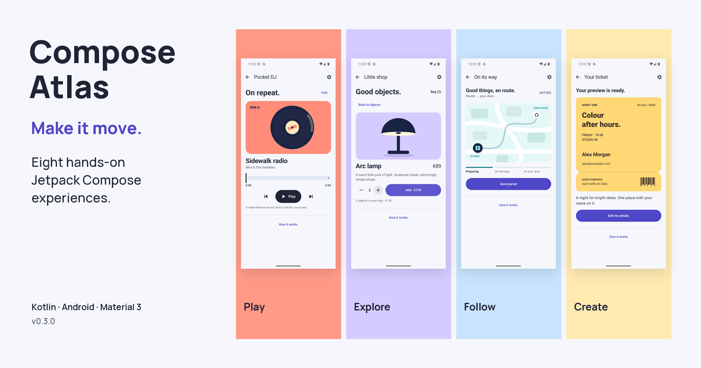

# Compose Atlas

**Eight familiar app moments. Touch one to see how it works.**

Fold a record player, follow a parcel across town, turn a name into a ticket or
watch a crowded morning make room. Compose Atlas is an offline Android lab of
small, working interfaces. Each scene starts with an ordinary task; **How it
works** explains the Compose mechanism, where it fits in a real app and its limits.



**v0.3.0 — eight hands-on Compose experiences.** Follow the [visual tour](docs/visual-tour.md)
for actions to try, or browse the [screen presentation](docs/presentation/README.md).
The [verification record](docs/verification.md) links local checks and the publication
record. The earlier five-scene gallery remains available at [v0.2.0](https://github.com/FredDevAxes/compose-atlas/tree/v0.2.0).

Everything runs with fictional local data and original geometric artwork. The
player is silent; the shop charges nothing; no parcel, email or ticket is sent.
No account, backend or paid service is needed. Emulator results do not establish
hardware performance or accessibility certification.

[Run locally](#run-locally) · [Visual tour](docs/visual-tour.md) ·
[Capability map](docs/coverage.md) · [Architecture](docs/architecture.md)

## Choose a moment

| Scene | Try it | A real application of the pattern |
| --- | --- | --- |
| Pocket DJ | Play, change track, seek and fold the sleeve | Persistent music or podcast player |
| Little shop | Open an object, change quantity and add it to the demo bag | Catalog-to-detail continuity with shared elements |
| On its way | Send a parcel and follow its progress | A route, onboarding journey or delivery status |
| Energy story | Find the evening peak; inspect the missing noon reading | A chart with consistent touch and text inspection |
| Your ticket | Submit empty fields, then make a local ticket preview | Registration, booking and confirmation |
| Poster studio | Pinch, rotate, drag or use the zoom and rotation buttons | Image inspection or a lightweight visual editor |
| Inbox zero | Archive a message, undo it, then clear the inbox | A list with stable identity and reversible actions |
| Make room | Move coffee to 11:00 and watch the schedule reflow | Time-based layout and overlap handling |

The settings screen offers one motion preference: **Normal**, **Slow motion** or
**Off**. There are no per-scene technical controls. Slow stretches authored tweens
and softens springs; Off takes authored transitions to their final state. Android's
animation scale still applies. Direct gestures continue to follow your fingers.
Light and dark themes follow the system.

## Run locally

Clone the repository and select the verified milestone:

```sh
git clone https://github.com/FredDevAxes/compose-atlas.git
cd compose-atlas
git switch --detach v0.3.0
```

Run all following commands from the repository root. To follow ongoing development,
use `git switch main` instead of the milestone checkout.

You need JDK 17, Android SDK Platform 36, Build Tools 36.0.0, platform-tools and
an Android 8.0/API 26 or newer emulator or device. The configured instrumented
CI target is API 36; a minimum API declaration does not prove a device test passed.

1. Point your environment at JDK 17 and the Android SDK. On macOS:

   ```sh
   export JAVA_HOME="$(/usr/libexec/java_home -v 17)"
   export ANDROID_HOME="$HOME/Library/Android/sdk"
   export PATH="$ANDROID_HOME/platform-tools:$ANDROID_HOME/cmdline-tools/latest/bin:$PATH"
   ```

   Use your installed paths on Linux or Windows. Android Studio can instead create
   an ignored `local.properties` with `sdk.dir`. No credentials are required.

2. Install the SDK packages, accept the SDK licenses if prompted, and build:

   ```sh
   sdkmanager "platforms;android-36" "build-tools;36.0.0" "platform-tools"
   ./gradlew assembleDebug
   ```

   Gradle downloads the pinned dependencies on the first build. Initial setup needs
   internet access; running the app does not. The APK is
   `app/build/outputs/apk/debug/app-debug.apk`. On Windows use `gradlew.bat`.

3. Start one emulator in Android Studio Device Manager, then install and launch:

   ```sh
   adb devices
   ./gradlew installDebug
   adb shell am start -n dev.devaxes.composeatlas/.MainActivity
   ```

   The app opens the eight-scene gallery. With multiple connected targets, use
   `adb -s DEVICE_ID install -r app/build/outputs/apk/debug/app-debug.apk` and
   `adb -s DEVICE_ID shell am start -n dev.devaxes.composeatlas/.MainActivity`.

## Check the work

```sh
./gradlew ktlintCheck lintDebug testDebugUnitTest assembleDebug
./gradlew connectedDebugAndroidTest
```

The second command needs one running emulator. Keep system Animator duration scale
at 1× for tests that inspect intermediate frames; motion-off is a separate behavior.
Reports are written under `app/build/reports/`.

ktlint 1.7.1 checks Kotlin source and app Gradle Kotlin scripts. Run
`./gradlew ktlintFormat` before checks, never concurrently. Android Lint treats
warnings as errors; dependency and target-update notices are excluded because this
toolchain is pinned. API compatibility checks remain enabled.

The [workflow](.github/workflows/android.yml) configures the same checks for every
push and PR, with a separate API 36 x86_64 emulator job and actions pinned to commit
SHAs. Results and the scope of the tests belong in [verification](docs/verification.md);
older green runs do not verify a later revision.

## Read and reuse the code

One Gradle application contains the gallery, eight scene files and deterministic
helpers. State stays close to the interaction; saveable values preserve scene
choices, while effects end when their scene leaves composition. There is no
asynchronous repository or backend to justify a ViewModel/DI layer in this lab.

- [Scene catalog](app/src/main/java/dev/devaxes/composeatlas/data/AtlasScene.kt):
  invitations, explanations, production use cases and boundaries.
- [Gallery and navigation](app/src/main/java/dev/devaxes/composeatlas/ui/ExperimentGallery.kt):
  saved routes, independent scene state, insets and explanations.
- [Theme and motion](app/src/main/java/dev/devaxes/composeatlas/ui/AtlasTheme.kt):
  system light/dark palettes and the shared authored-motion policy.
- [Scene implementations](app/src/main/java/dev/devaxes/composeatlas/ui/scenes):
  interaction state, Material components and runtime Canvas artwork.
- [Architecture and reuse notes](docs/architecture.md), [capability map](docs/coverage.md)
  and [design record](DESIGN.md).

Little shop opts into `SharedTransitionLayout`, experimental in pinned Compose
1.9.0. That opt-in and its version need review when extracting the scene. The
[capability map](docs/coverage.md) distinguishes working patterns from future areas
such as View interop, asynchronous data and hardware profiling. This is not a
catalog of every Compose API or a complete production application.

## Reproduction and licensing

Gradle 8.13 has a distribution checksum. Android Gradle Plugin 8.12.0, Kotlin 2.2.10,
Compose UI/Foundation/Animation 1.9.0, Material 3 1.3.2 and ktlint 1.7.1 are pinned;
resolved application dependencies are in `app/gradle.lockfile`. No dependency was
added for the redesign. JDK patches, SDK package revisions, emulator system images
and hosted runners are not fully locked by Gradle; record them when comparing runs.
The release build is unsigned.

Original code is [MIT licensed](LICENSE). [Third-party notices](NOTICE.md) retain
dependency licenses and artwork provenance. Historical checks for the previous
public gallery are [archived separately](docs/archive/verification-v0.2.0.md).
