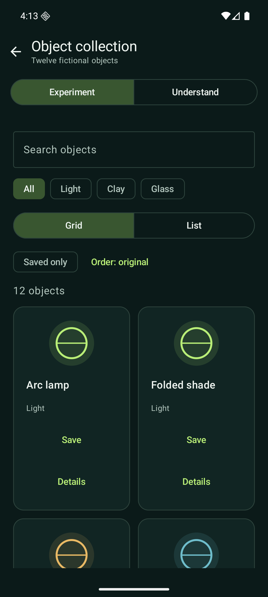

# Compose Atlas

**Try the interaction. Change its behavior. Understand the Compose behind it.**

An Android lab that makes Jetpack Compose tangible through five small, working
interfaces. Compare a spring with a timed animation, fold a fictional audio player,
reorder a collection, validate a form or rearrange a timeline. Each experiment
pairs hands-on controls with an **Understand** tab.

[](https://github.com/FredDevAxes/compose-atlas/actions/workflows/android.yml)
[](LICENSE)

<p>
  
  
  
</p>

*Native Android captures from [v0.2.0](https://github.com/FredDevAxes/compose-atlas/tree/v0.2.0):
player, collection and agenda. The [visual tour](docs/visual-tour.md) covers all five experiments.*

**Status:** an evolving, offline lab, verified on API 36 emulators. All data is
synthetic. The player makes no sound and the form sends nothing. No account,
backend or paid service is needed. Hardware performance has not been measured.

[Run locally](#run-it) · [Choose an experiment](#choose-an-experiment) ·
[Visual tour](docs/visual-tour.md) · [Capability map](docs/coverage.md) ·
[Verification](docs/verification.md)

## Run it

You need JDK 17, Android SDK Platform 36, Build Tools 36.0.0, platform-tools, and an
Android 8.0/API 26 or newer emulator or device. Initial verification targets an API
36 emulator; API 26 compatibility is checked by lint, not a device run.

1. Clone the repository.

   ```sh
   git clone https://github.com/FredDevAxes/compose-atlas.git
   cd compose-atlas
   ```

2. Point your environment at JDK 17 and the Android SDK. On macOS, a typical setup is:

   ```sh
   export JAVA_HOME="$(/usr/libexec/java_home -v 17)"
   export ANDROID_HOME="$HOME/Library/Android/sdk"
   export PATH="$ANDROID_HOME/platform-tools:$ANDROID_HOME/cmdline-tools/latest/bin:$PATH"
   ```

   On Linux or Windows, use your installed JDK 17 and SDK paths. Android Studio can
   also create an ignored `local.properties` with `sdk.dir`. No keys are required.

3. Install the SDK packages, accept the Android SDK licenses if needed, and build.

   ```sh
   sdkmanager "platforms;android-36" "build-tools;36.0.0" "platform-tools"
   ./gradlew assembleDebug
   ```

   Gradle downloads the pinned dependencies on the first build; no separate package
   installation command is needed. Internet access is needed for this initial setup.

   The APK is `app/build/outputs/apk/debug/app-debug.apk`. Windows users can replace
   `./gradlew` with `gradlew.bat`.

4. Start an emulator from Android Studio Device Manager, then install and launch.

   ```sh
   adb devices
   ./gradlew installDebug
   adb shell am start -n dev.devaxes.composeatlas/.MainActivity
   ```

   Keep one target connected for `installDebug`, or install the APK explicitly with
   `adb -s DEVICE_ID install -r app/build/outputs/apk/debug/app-debug.apk`. Use the
   same `-s DEVICE_ID` for launch. The app opens Explore with five experiments.

## Choose an experiment

| Scene | Try this | What to watch |
| --- | --- | --- |
| Quiet frequency | Play, seek, change track, compact the player | Title transitions, size animation, gesture ownership and a cancellable clock |
| Object collection | Save Arc lamp, reverse, filter, switch Grid/List | Stable item identity, reordering motion and restored favorites |
| Session builder | Submit empty input, then use Next and Done on the keyboard | Error feedback, focus movement and a local confirmation |
| Spatial agenda | Overlap sessions, zoom, move Motion workshop | Time-driven placement and columns for overlapping events |
| Temperature study | Replay Tween and Spring at 0.25× | Duration-based easing versus spring overshoot |

Every scene has an **Understand** tab. Scene inputs and settings survive activity recreation;
transient animation progress does not.
Returning to the player restores its position paused. The agenda uses a list in
narrow windows or with enlarged text; the normal phone shows a custom timeline.
The [coverage map](docs/coverage.md) lists implemented capabilities and candidates
for later milestones.

Follow the [guided visual tour](docs/visual-tour.md) for a short scenario in each
scene, including empty states, animation controls and keyboard behavior.

## Check it

```sh
./gradlew ktlintCheck lintDebug testDebugUnitTest assembleDebug
./gradlew connectedDebugAndroidTest
```

The second command needs one running emulator. Keep the system Animator duration
scale at 1× for the test that examines intermediate animation frames; motion-off
behavior is tested separately. The UI also respects the system motion scale.

`ktlintCheck` covers the Kotlin source and Gradle Kotlin scripts in the app project.
Use `./gradlew ktlintFormat` before checking, not concurrently with checks. Android
Lint treats warnings as errors; update-availability notices are excluded because
the toolchain and tested API 36 target are intentionally pinned. `OldTargetApi` is
an excluded update notice; Android API usage compatibility checks remain enabled.

Unit tests exercise chart coordinates, nearest-sample boundaries, gap segmentation,
distinct fixtures, filtering, validation and interval placement. Instrumented tests
cover all five scenes, navigation, state recreation, playback completion, keyboard
actions, scenarios and controlled chart animation time.
Reports are under `app/build/reports/`.

GitHub Actions runs the same checks on every push and PR, with a separate API 36
x86_64 emulator job. Workflow actions are pinned to commit SHAs. Local tests use an
ARM64 emulator; these are different execution environments.

The [v0.2.0 CI run](https://github.com/FredDevAxes/compose-atlas/actions/runs/38670901824)
passed both jobs. Locally, **13 unit tests and 14 instrumented tests** passed on
API 36 ARM64; navigation was also checked with enlarged text and a wide window.
See [verification](docs/verification.md) for environments, scope and remaining limits.

## How the lab grows

| Milestone | Working scope |
| --- | --- |
| [v0.1.0](https://github.com/FredDevAxes/compose-atlas/tree/v0.1.0) | First Canvas chart, inspection, settings and synthetic edge cases |
| [Motion comparison](https://github.com/FredDevAxes/compose-atlas/commit/84238116c4653854273217cf12cc1278b49f82a7) | Parallel Tween/Spring markers and 1× / 0.5× / 0.25× playback |
| [v0.2.0](https://github.com/FredDevAxes/compose-atlas/tree/v0.2.0) | Five experiments, independent scene state and per-scene explanations |

The [capability map](docs/coverage.md) separates implemented APIs from candidates
such as rich text, adaptive navigation, advanced gestures, themes and View interop.
This lab aims to explore Compose progressively; it does not cover every API today.

## Source map

- [Gallery and shared shell](app/src/main/java/dev/devaxes/composeatlas/ui/ExperimentGallery.kt):
  five destinations with saved scene state.
- [Player](app/src/main/java/dev/devaxes/composeatlas/ui/PlayerExperience.kt),
  [collection](app/src/main/java/dev/devaxes/composeatlas/ui/CollectionExperience.kt),
  [form](app/src/main/java/dev/devaxes/composeatlas/ui/FormExperience.kt), and
  [agenda](app/src/main/java/dev/devaxes/composeatlas/ui/AgendaExperience.kt):
  self-contained scenes and their explanations.

- [Gallery data and algorithms](app/src/main/java/dev/devaxes/composeatlas/data/GalleryData.kt):
  filtering, local validation and overlap lanes.
- [Data and chart math](app/src/main/java/dev/devaxes/composeatlas/data/TemperatureData.kt):
  deterministic fixtures, state transitions and gap-preserving segments.
- [Canvas](app/src/main/java/dev/devaxes/composeatlas/ui/TemperatureChart.kt):
  shared coordinates for traces, markers and pointer input.
- [Motion comparison](app/src/main/java/dev/devaxes/composeatlas/ui/MotionComparison.kt):
  parallel markers and playback speed composed with Android animation scale.
- [Screen state and layout](app/src/main/java/dev/devaxes/composeatlas/ui/AtlasApp.kt):
  saved chart settings and replay.
- [Controls and explanations](app/src/main/java/dev/devaxes/composeatlas/ui/ControlPanel.kt):
  Adjust / Understand and reproducible scenarios.
- [Architecture and tradeoffs](docs/architecture.md), [design](DESIGN.md), and
  [capability coverage](docs/coverage.md).

One Gradle application is enough for this milestone. Additional experiences can
introduce module boundaries when there is a concrete need to share or isolate code.

## Reproduction boundaries

Gradle 8.13 has a distribution checksum; Android Gradle Plugin 8.12.0, Kotlin 2.2.10,
Compose UI/Foundation/Animation 1.9.0, Material 3 1.3.2 and ktlint 1.7.1 are pinned.
Resolved app dependencies are recorded in `app/gradle.lockfile`. JDK patches, SDK
package revisions, emulator system images and hosted-runner images are not fully
locked by Gradle. Record them when comparing runs.

The release build is unsigned. There is no store publication, analytics, account,
or production service. No real-device smoothness, energy use or accessibility
certification is claimed.

[Third-party notices](NOTICE.md) retain their original licenses.
