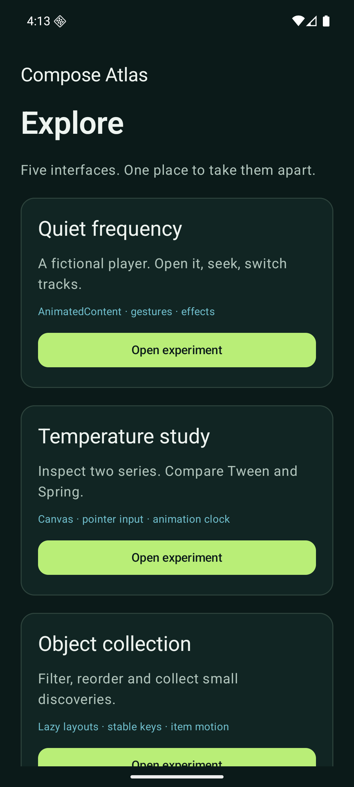
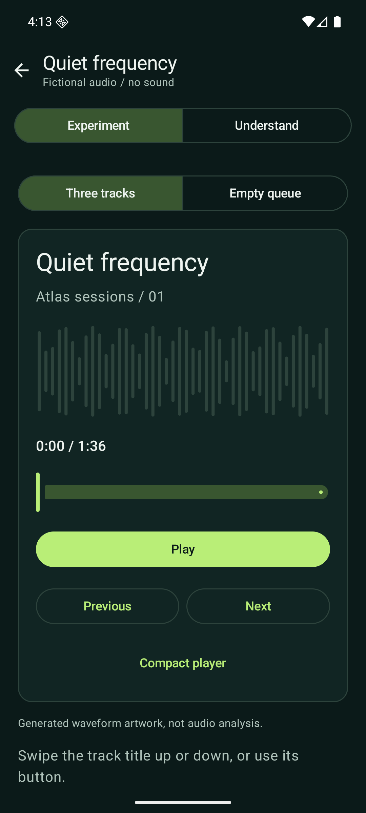
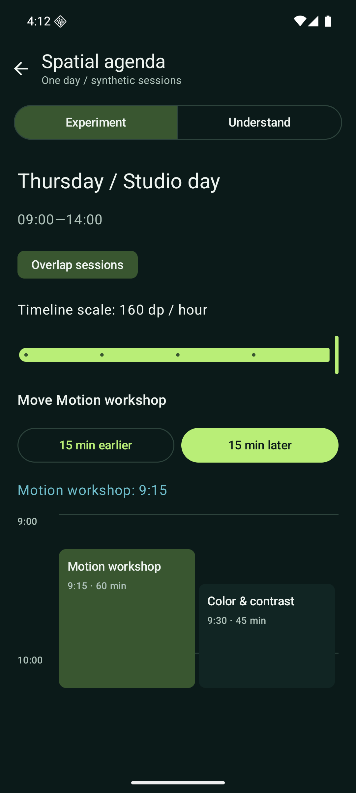

# Compose Atlas

An Android lab for trying Jetpack Compose in a working interface, then inspecting how it behaves.

Five experiments turn Compose APIs into things you can try: a chart, a fictional
audio player, an object collection, a form and a custom timeline. Change a setting,
observe the result, then open **Understand** for the mechanism behind it.
All content is synthetic; the player makes no sound and the form sends nothing.

This is a small, evolving lab. It does not read sensors, need an account, or call a
backend. Device performance has not been measured. The original code is [MIT](LICENSE).

<p>
  
  
  
</p>

## Run it

You need JDK 17, Android SDK Platform 36, Build Tools 36.0.0, platform-tools, and an
Android 8.0/API 26 or newer emulator or device. Initial verification targets an API
36 emulator; API 26 compatibility is checked by lint, not a device run.

1. Clone the repository.

   ```sh
   git clone https://github.com/FredDevAxes/compose-atlas.git
   cd compose-atlas
   ```

2. Point your environment at JDK 17 and the Android SDK. On macOS, a typical setup is:

   ```sh
   export JAVA_HOME="$(/usr/libexec/java_home -v 17)"
   export ANDROID_HOME="$HOME/Library/Android/sdk"
   export PATH="$ANDROID_HOME/platform-tools:$ANDROID_HOME/cmdline-tools/latest/bin:$PATH"
   ```

   On Linux or Windows, use your installed JDK 17 and SDK paths. Android Studio can
   also create an ignored `local.properties` with `sdk.dir`. No keys are required.

3. Install the SDK packages, accept the Android SDK licenses if needed, and build.

   ```sh
   sdkmanager "platforms;android-36" "build-tools;36.0.0" "platform-tools"
   ./gradlew assembleDebug
   ```

   The APK is `app/build/outputs/apk/debug/app-debug.apk`. Windows users can replace
   `./gradlew` with `gradlew.bat`.

4. Start an emulator from Android Studio Device Manager, then install and launch.

   ```sh
   adb devices
   ./gradlew installDebug
   adb shell am start -n dev.devaxes.composeatlas/.MainActivity
   ```

   Use `adb -s DEVICE_ID` when more than one device is connected. Open
   any experiment from Explore.

## Choose an experiment

| Scene | Try this | What to watch |
| --- | --- | --- |
| Quiet frequency | Play, seek, change track, compact the player | Title transitions, size animation, gesture ownership and a cancellable clock |
| Object collection | Save Arc lamp, reverse, filter, switch Grid/List | Stable item identity, reordering motion and restored favorites |
| Session builder | Submit empty input, then use Next and Done on the keyboard | Error feedback, focus movement and a local confirmation |
| Spatial agenda | Overlap sessions, zoom, move Motion workshop | Time-driven placement and columns for overlapping events |
| Temperature study | Replay Tween and Spring at 0.25× | Duration-based easing versus spring overshoot |

Every scene has an **Understand** tab. Changes survive activity recreation.
Returning to the player restores its position paused. The agenda uses a list in
narrow windows or with enlarged text; the normal phone shows a custom timeline.
The [coverage map](docs/coverage.md) lists implemented capabilities and candidates
for later milestones.

### Explore the temperature chart

- **Inspect:** drag or tap the chart. Previous point and Next point provide the same
  selection without requiring a precise gesture.
- **Compare:** show Studio, Gallery, or both. The last visible series cannot be hidden.
- **Change periods:** Day, Week and Month use distinct deterministic fixtures.
- **Adjust:** choose Tween with duration, or Spring with damping and stiffness.
  Replay reveals the existing trace; it never invents intermediate measurements.
- **Compare motion:** Replay both starts two markers together. The amber line is the
  100% target; Spring can overshoot it while Tween stops at it. Choose 1×, 0.5× or
  0.25× to slow playback without changing the curves. The highlighted lane drives
  the chart. The spring defaults to damping 0.45 so its bounce is visible.
- **Understand:** read the mapping from touch to values, inspect the relevant APIs,
  and follow View source.
- **Break the happy path:** choose Empty, Gaps or Long labels. Gaps break the path
  and read as “No sample”; they do not become zero.
- **Reset:** restore the default fixture, time, series and animation settings.
- **Return:** system Back first closes the panel, then returns to Explore.

The panel scrolls independently while the chart remains visible on a normal portrait
phone. Short windows and large fonts use a vertically scrollable layout. Activity recreation
restores the selected sample and settings.

## Check it

```sh
./gradlew ktlintCheck lintDebug testDebugUnitTest assembleDebug
./gradlew connectedDebugAndroidTest
```

The second command needs one running emulator. Keep the system Animator duration
scale at 1× for the test that examines intermediate animation frames; motion-off
behavior is tested separately. The UI also respects the system motion scale.

`ktlintCheck` covers the Kotlin source and Gradle Kotlin scripts in the app project.
Use `./gradlew ktlintFormat` before checking, not concurrently with checks. Android
Lint treats warnings as errors; update-availability notices are excluded because
the toolchain and tested API 36 target are intentionally pinned. `OldTargetApi` is
an excluded update notice; Android API usage compatibility checks remain enabled.

Unit tests exercise chart coordinates, nearest-sample boundaries, gap segmentation,
distinct fixtures, filtering, validation and interval placement. Instrumented tests
cover all five scenes, navigation, state recreation, playback completion, keyboard
actions, scenarios and controlled chart animation time.
Reports are under `app/build/reports/`.

GitHub Actions runs the same checks on every push and PR, with a separate API 36
x86_64 emulator job. Workflow actions are pinned to commit SHAs. Local tests use an
ARM64 emulator; these are different execution environments.

See [verification](docs/verification.md) for actual runs and remaining limits.

## Source map

- [Gallery and shared shell](app/src/main/java/dev/devaxes/composeatlas/ui/ExperimentGallery.kt):
  five destinations with saved scene state.
- [Player](app/src/main/java/dev/devaxes/composeatlas/ui/PlayerExperience.kt),
  [collection](app/src/main/java/dev/devaxes/composeatlas/ui/CollectionExperience.kt),
  [form](app/src/main/java/dev/devaxes/composeatlas/ui/FormExperience.kt), and
  [agenda](app/src/main/java/dev/devaxes/composeatlas/ui/AgendaExperience.kt):
  self-contained scenes and their explanations.

- [Data and chart math](app/src/main/java/dev/devaxes/composeatlas/data/TemperatureData.kt):
  deterministic fixtures, state transitions and gap-preserving segments.
- [Canvas](app/src/main/java/dev/devaxes/composeatlas/ui/TemperatureChart.kt):
  shared coordinates for traces, markers and pointer input.
- [Motion comparison](app/src/main/java/dev/devaxes/composeatlas/ui/MotionComparison.kt):
  parallel markers and playback speed composed with Android animation scale.
- [Screen state and layout](app/src/main/java/dev/devaxes/composeatlas/ui/AtlasApp.kt):
  saved chart settings and replay.
- [Controls and explanations](app/src/main/java/dev/devaxes/composeatlas/ui/ControlPanel.kt):
  Adjust / Understand and reproducible scenarios.
- [Architecture and tradeoffs](docs/architecture.md), [design](DESIGN.md), and
  [capability coverage](docs/coverage.md).

One Gradle application is enough for this milestone. Additional experiences can
introduce module boundaries when there is a concrete need to share or isolate code.

## Reproduction boundaries

Gradle 8.13 has a distribution checksum; Android Gradle Plugin 8.12.0, Kotlin 2.2.10,
Compose UI/Foundation/Animation 1.9.0, Material 3 1.3.2 and ktlint 1.7.1 are pinned.
Resolved app dependencies are recorded in `app/gradle.lockfile`. JDK patches, SDK
package revisions, emulator system images and hosted-runner images are not fully
locked by Gradle. Record them when comparing runs.

The release build is unsigned. There is no store publication, analytics, account,
or production service. No real-device smoothness, energy use or accessibility
certification is claimed.

[Third-party notices](NOTICE.md) retain their original licenses.
