# Compose Atlas — the screen gallery


Eleven views of the eight-scene Android lab, composed from actual emulator screenshots.
The [visual tour](../visual-tour.md) explains actions to try; the [raw captures](../images/redesign/manifest.json) retain their source and environment.

## Make it move.

Eight familiar app moments. Choose one. See Compose respond.

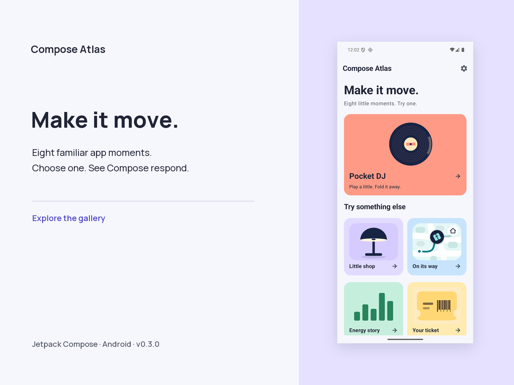

## Pocket DJ

Play a little. Fold it away. A player that moves with its state.

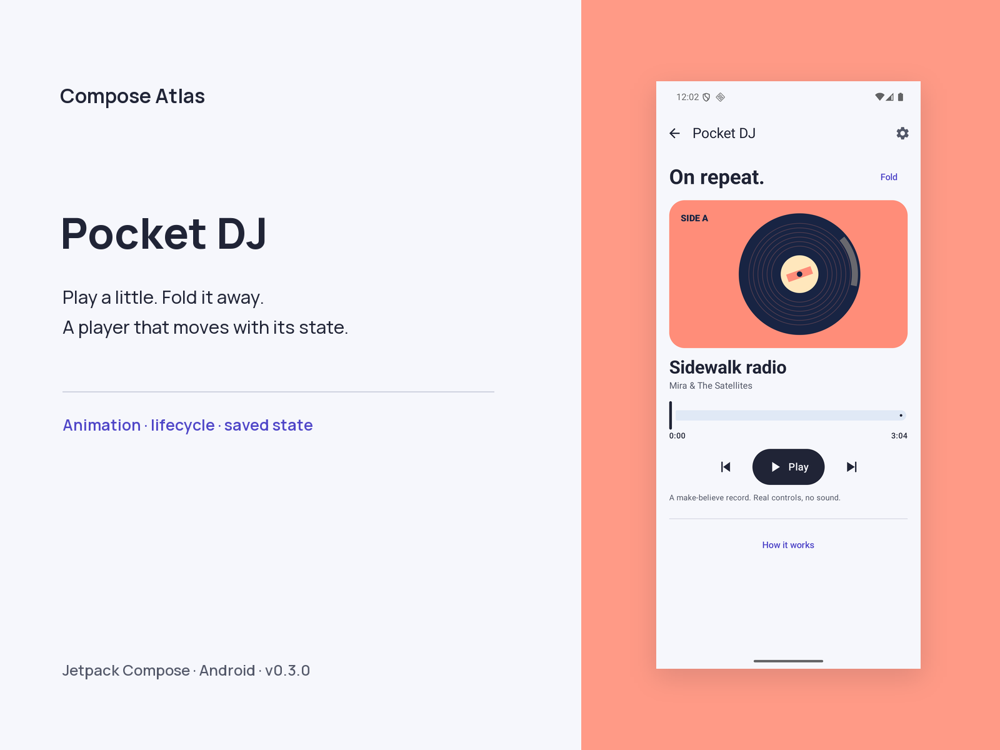

## Little shop

Open an object. Keep its identity. From collection to detail and bag.

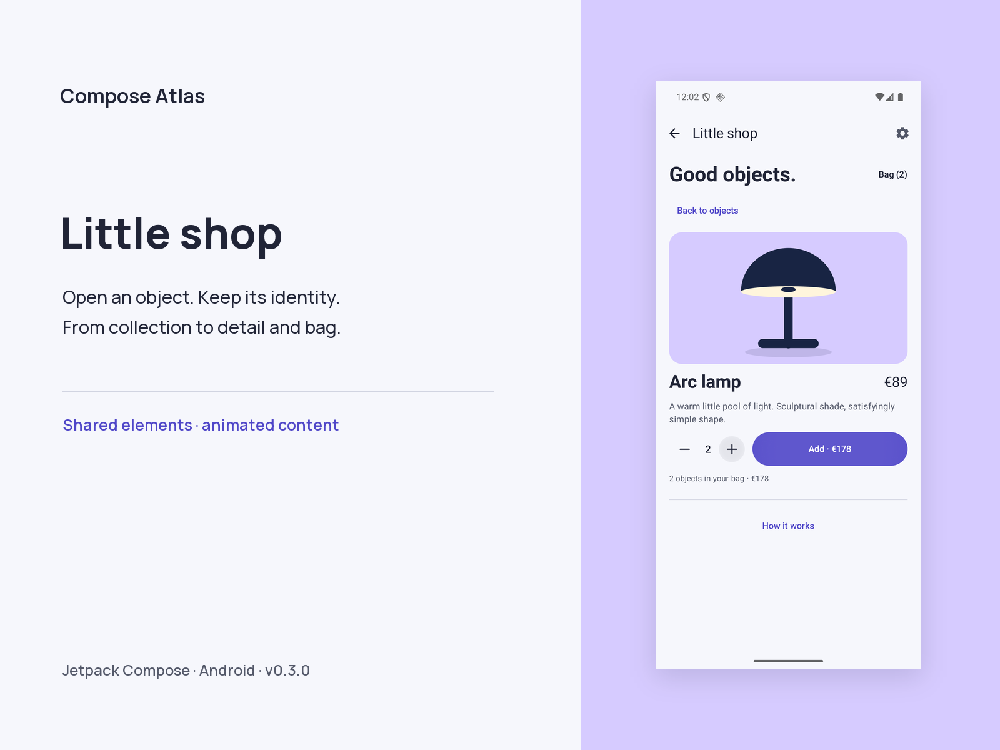

## On its way

Send a parcel. Follow the journey. One route drives motion and status.

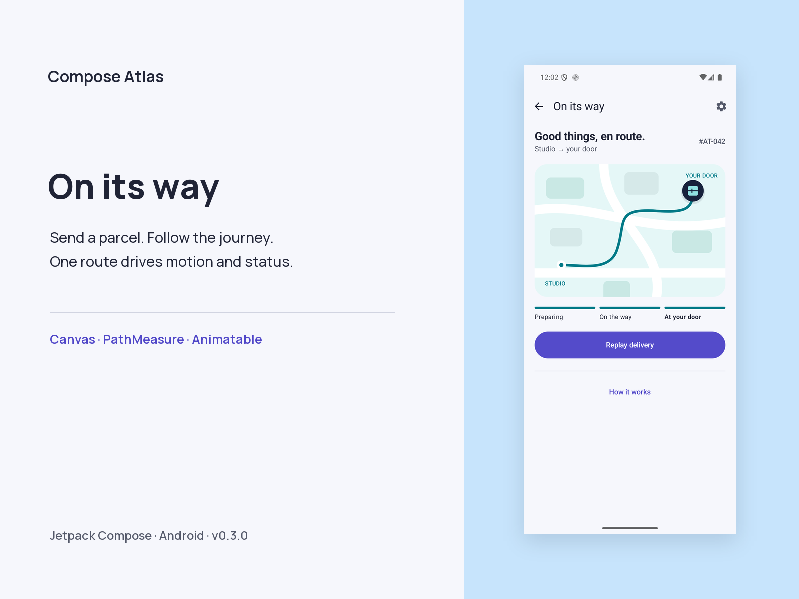

## Energy story

Touch a bar. Inspect a reading. A missing sample stays a gap.

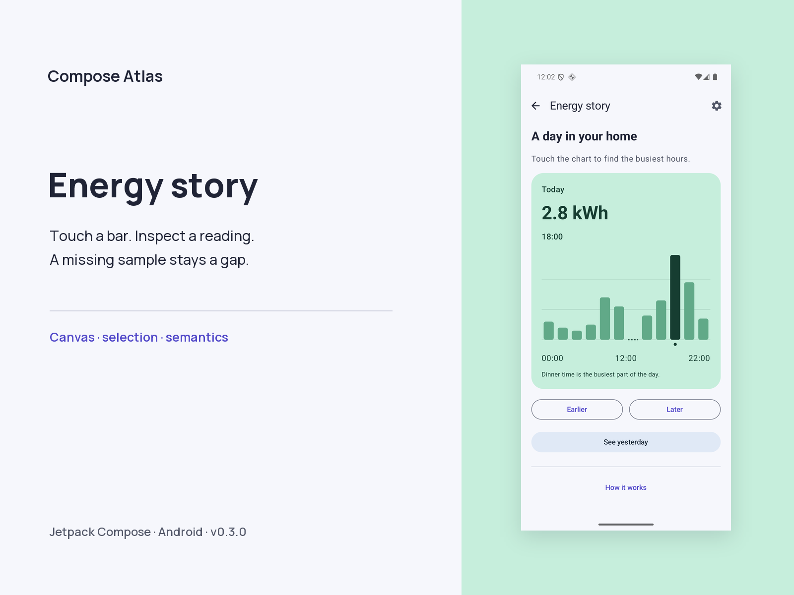

## Your ticket

Enter your details. Make a preview. A form becomes a golden ticket.

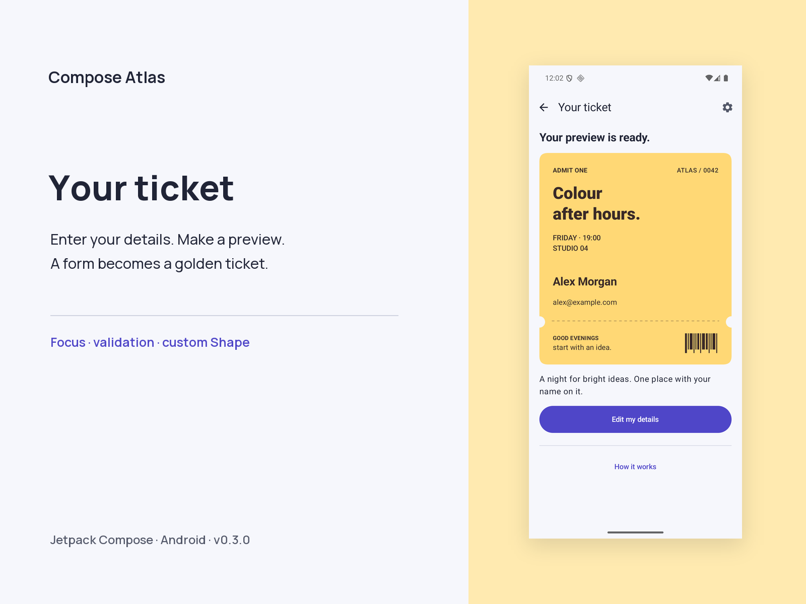

## Poster studio

Pinch. Turn. Find another angle. Direct gestures with visible controls.

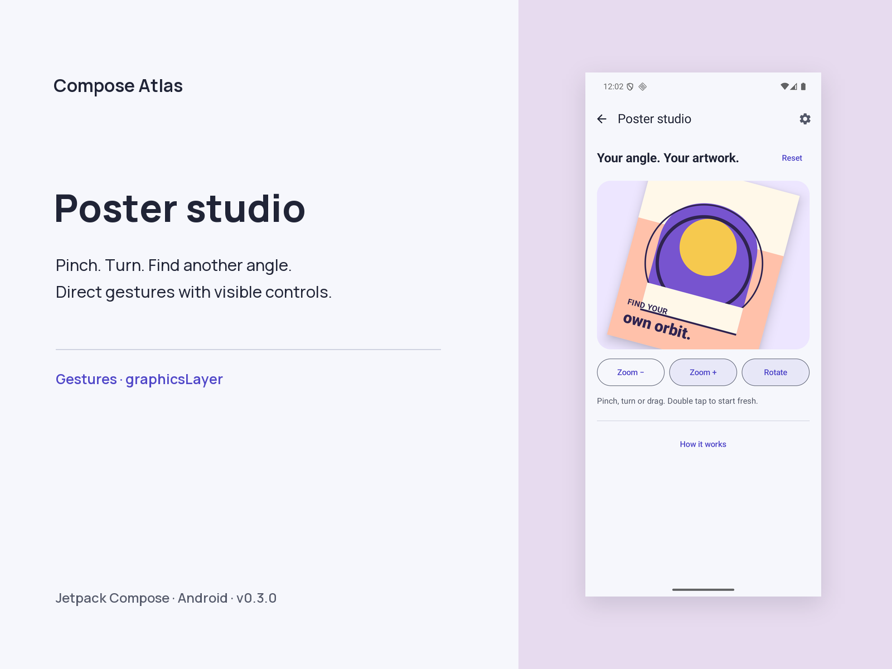

## Inbox zero

Swipe a message. Make some room. Change your mind with Undo.

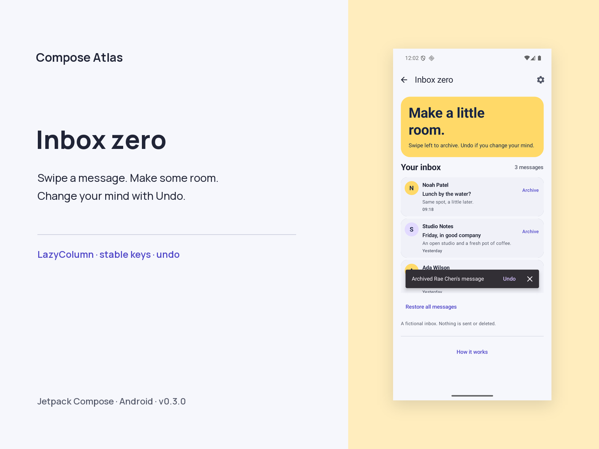

## Make room

Move coffee. Watch the morning adjust. A custom layout resolves the overlap.

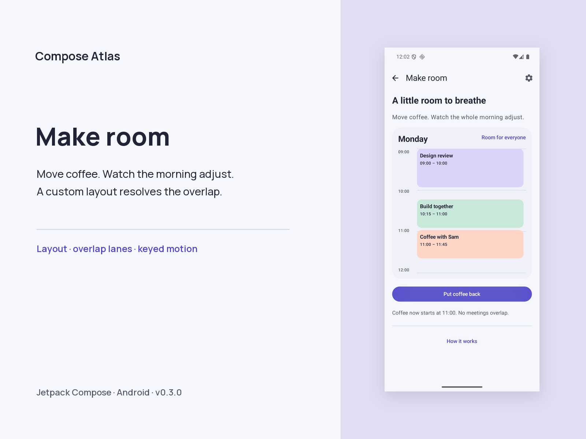

## At your pace

Normal, slow motion or off. One preference for every experience.

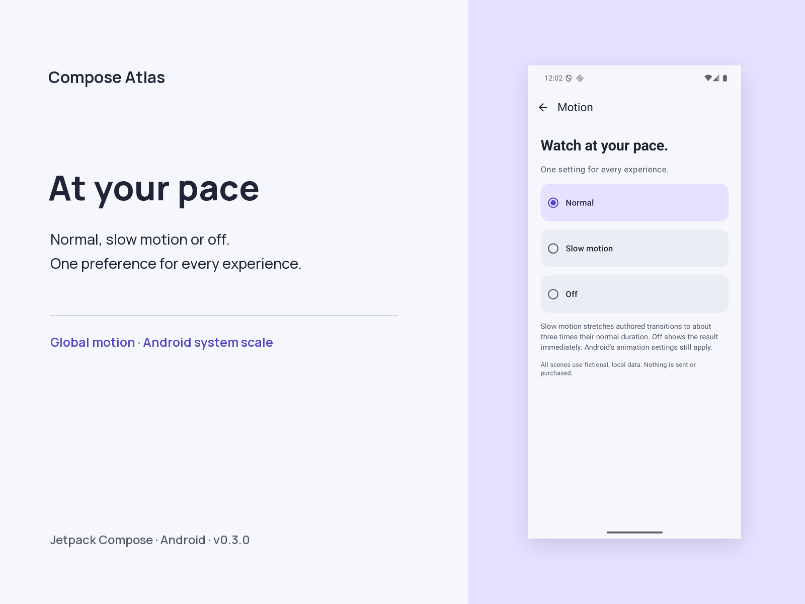

## See how it works

Try the interaction, then look inside. Mechanism, production use and limits.

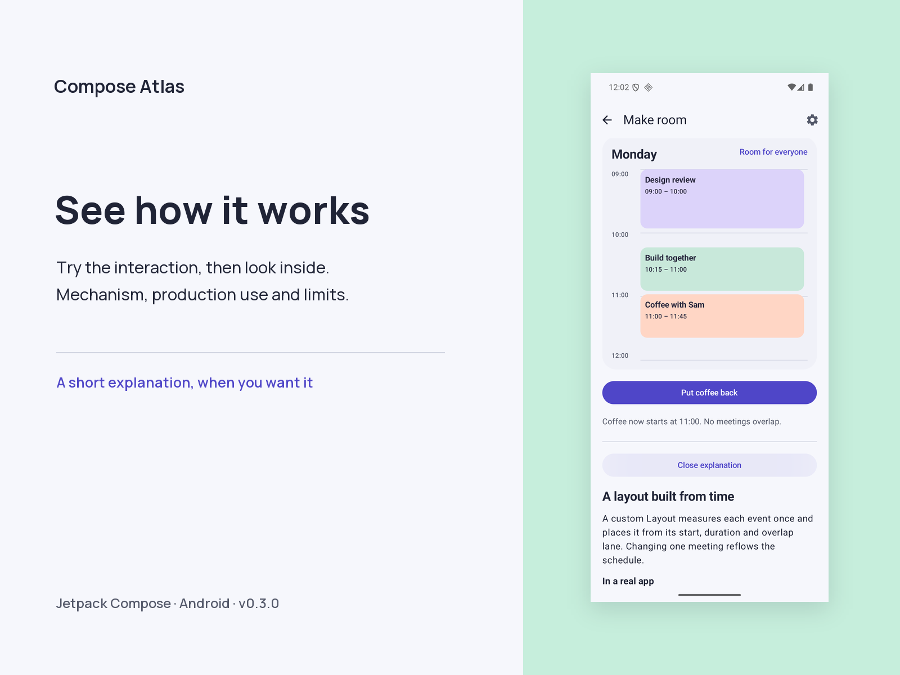

## Reproduce the images

From the repository root:

```sh
python3 -m venv .venv-presentation
. .venv-presentation/bin/activate
python -m pip install -r tools/presentation/requirements.txt
python tools/presentation/render.py
```

The renderer scales whole screenshots without cropping or retouching their UI. It adds a background, typography and an external shadow. The font is retained with its SIL Open Font License. [Manifest](manifest.json) records source files and hashes. The same capture set was verified in light, dark, enlarged-text and wide-window configurations; these presentation compositions use the light phone set.

This offline lab uses fictional data. The player is silent; no order, parcel or issued ticket is created. Emulator images do not establish physical-device performance or accessibility certification.
