# Eight moments to try

[README](../README.md) · [Capability map](coverage.md) · [Architecture](architecture.md) ·
[Verification](verification.md)

These native captures belong to the local eight-scene redesign on
`codex/compose-atlas-playground`, source commit `888c913`, not the public v0.2.0 tag.
They were captured on an Android 16/API 36 ARM64 emulator at 1080 × 2400 px,
420 dpi. The 20-step capture tour also completed in dark theme, at font scale 1.3
and in a 1600 × 1000 px, 160 dpi window. These are visual-state checks; the
[verification record](verification.md) distinguishes the 10 behavior tests from
the capture tour and records the six unit tests, build checks and clean local clone.

All scenes run offline with fictional data. Follow the task, then open **How it
works** for the mechanism, a production use case and its boundary.

## Start with something familiar

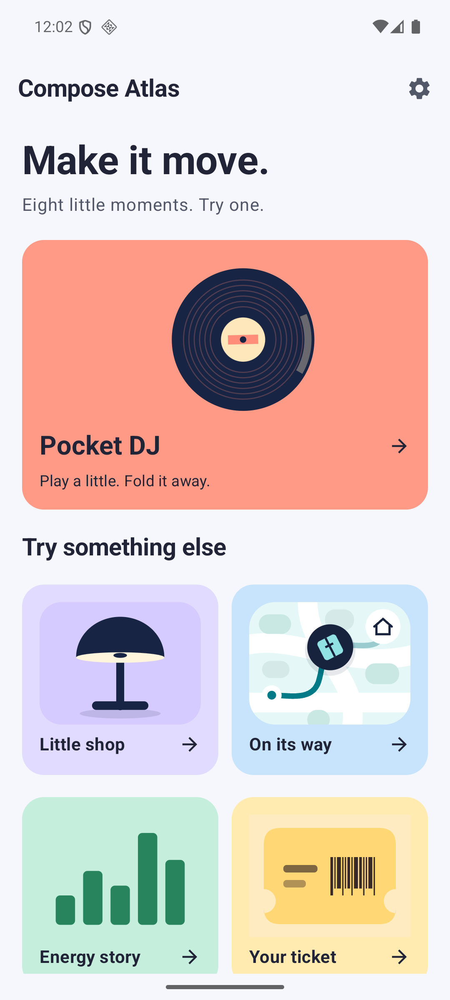

The gallery previews the objects you will manipulate. Choose the record player or
scroll to another scene. Use the settings icon to compare **Normal**, **Slow motion**
and **Off**; the preference applies across scenes. Android's animation scale still
applies. There is no per-scene tuning panel.

## Pocket DJ: fold the player

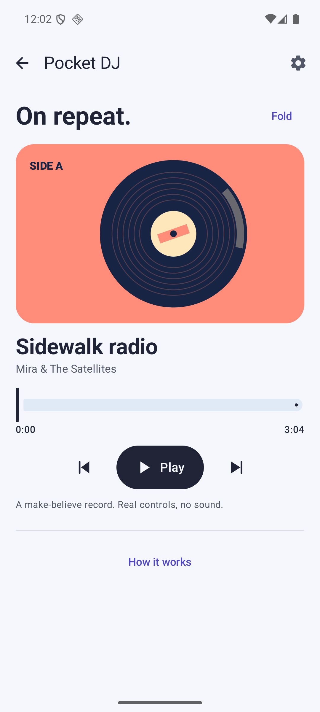

Press Play, move the seek slider and change tracks. Fold the sleeve, then expand
it again. Leave and return: track and position are saved, playback returns paused.

The sleeve size and title respond to player state; the record turns with the
simulated position. A cancellable effect owns the clock, and a lifecycle observer
pauses it when the app stops. This pattern can support a persistent mini-player;
the lab itself has no audio engine and makes no sound.

[MusicScene.kt](../app/src/main/java/dev/devaxes/composeatlas/ui/scenes/MusicScene.kt)

## Little shop: keep an object's identity

  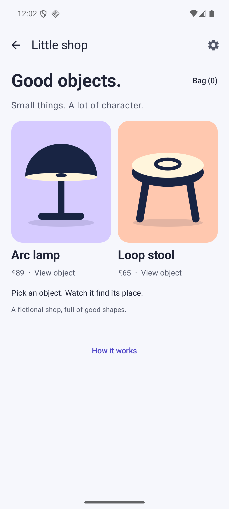
  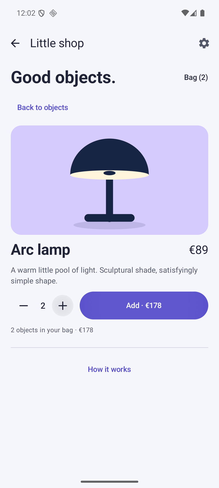

Open Arc lamp and watch the same artwork take its place in the detail. Change
quantity and add it to the demo bag. Return to the objects, open Loop stool and
compare. System Back from a detail returns to the collection first.

`SharedTransitionLayout` links each object by stable identity. It is experimental
in pinned Compose 1.9.0. Catalogs, travel apps and media libraries can use the same
continuity; here, the bag is local state and no order or payment is created.

[ShopScene.kt](../app/src/main/java/dev/devaxes/composeatlas/ui/scenes/ShopScene.kt)

## On its way: follow a route

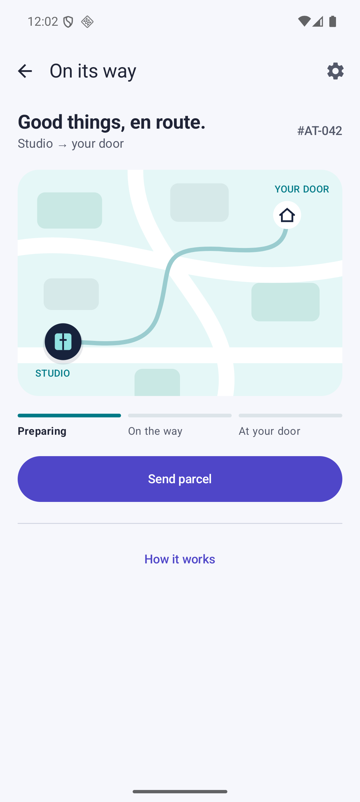

Send the parcel. Follow it from Preparing to On the way and At your door, then
replay. Try Slow motion before sending again; compare with Off.

The trail and courier share one `PathMeasure` geometry. Progress controls drawing
and status, illustrating delivery tracking or a guided workflow. The neighborhood
is drawn locally; there is no real location, map service or dispatch.

[DeliveryScene.kt](../app/src/main/java/dev/devaxes/composeatlas/ui/scenes/DeliveryScene.kt)

## Energy story: inspect the data

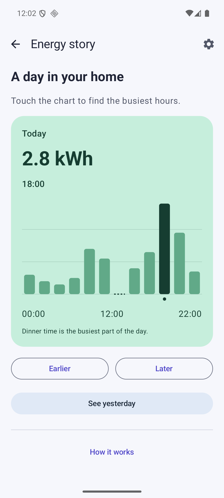

Touch or drag across the bars, then inspect the same readings with Earlier and
Later. Find the evening peak. Select noon to see the missing reading; switch to
yesterday and compare.

Chart geometry, selection and text inspection stay consistent. The text readout
uses fixture values rather than intermediate animation heights. A gap means “No
reading”, never zero. This is a reporting-interface pattern using illustrative
household data, with no measured consumption or energy-use claim.

[EnergyScene.kt](../app/src/main/java/dev/devaxes/composeatlas/ui/scenes/EnergyScene.kt)

## Your ticket: make a local preview

  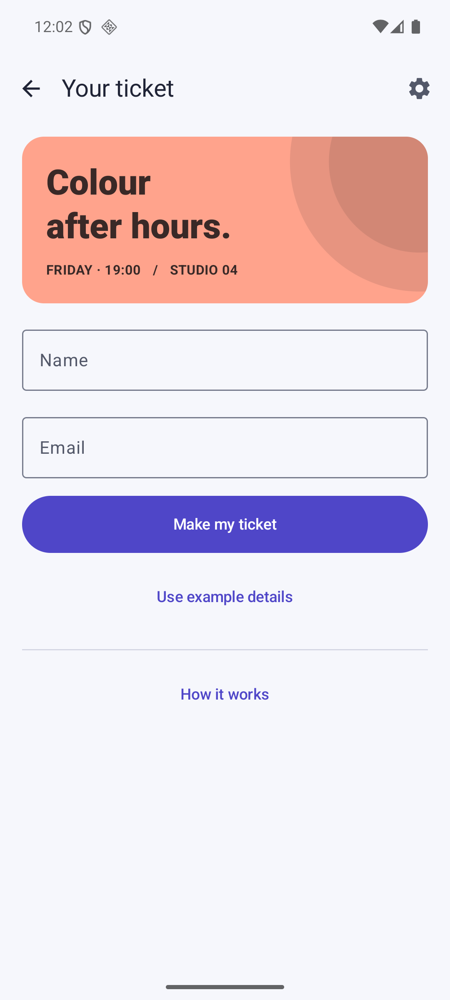
  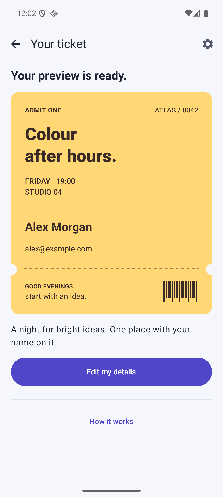

Try Make my ticket with empty fields. Enter a name; keyboard Next moves to Email
and Done runs the same validation as the button. Or choose Use example details.
Create the preview, then edit the details.

Input drives validation, focus and confirmation. A custom `Shape` cuts real notches
from the ticket outline. The pattern fits booking and registration; nothing is
submitted, the email format check does not establish that an address exists, and the decorative
barcode is not valid admission proof.

[TicketScene.kt](../app/src/main/java/dev/devaxes/composeatlas/ui/scenes/TicketScene.kt)

## Poster studio: take another angle

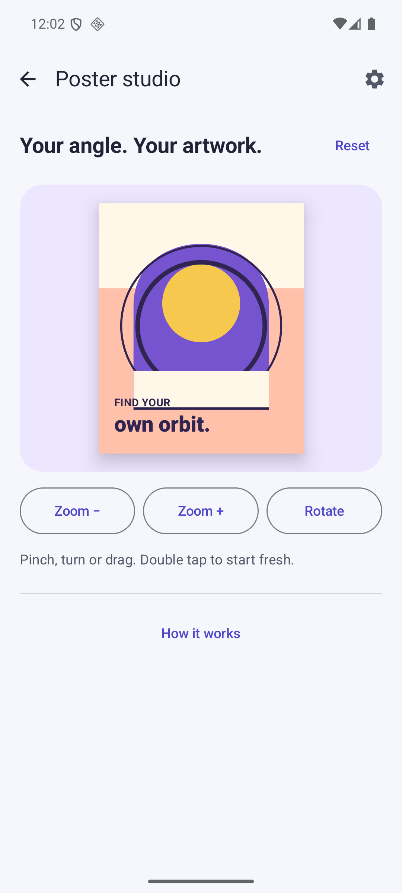

Pinch to zoom, rotate with two fingers and drag the poster. Compare the zoom and
rotation buttons. Double tap or use Reset to return to the starting composition.

`transformable` combines gesture changes; `graphicsLayer` applies them without
changing the poster's measured layout. A new gesture interrupts a button animation.
This fits image or document inspection. The artwork is original geometry; there
is no photo access, image export or external asset download.

[PhotoScene.kt](../app/src/main/java/dev/devaxes/composeatlas/ui/scenes/PhotoScene.kt)

## Inbox zero: undo a decision

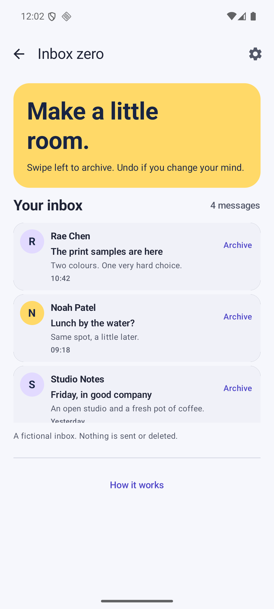

Swipe a message left or press Archive. Use Undo to bring it back to its original
position. Archive all four messages to see the empty state, then bring them back.

Stable keys preserve row identity as neighboring messages move. The snackbar makes
the latest archive reversible; restore resets swipe state before the item returns.
The pattern fits mail and task lists, but these messages have no connected account.

[InboxScene.kt](../app/src/main/java/dev/devaxes/composeatlas/ui/scenes/InboxScene.kt)

## Make room: change the morning

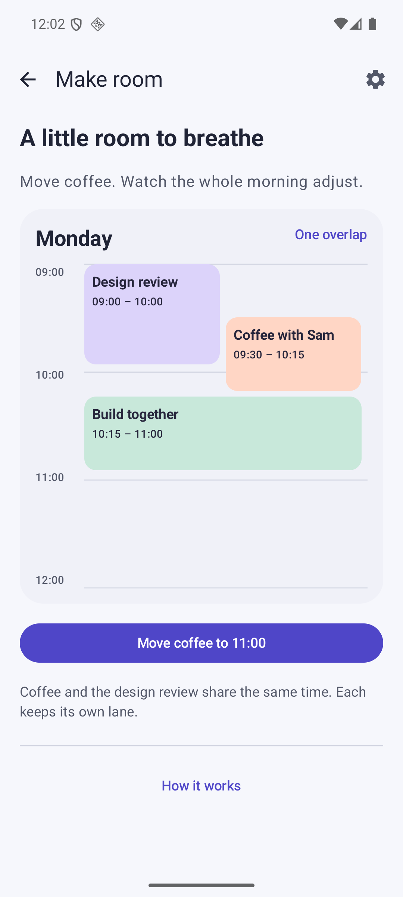

Move coffee to 11:00. Watch the overlap disappear and the event widths adjust.
Put coffee back. Increase the system text size to inspect the chronological list
adaptation.

A pure overlap calculation supplies lanes; a custom `Layout` measures each event
once and places it from time and duration. The pattern fits scheduling and booking
interfaces. This scene has no calendar account, drag-and-drop scheduling or remote
availability data.

[AgendaScene.kt](../app/src/main/java/dev/devaxes/composeatlas/ui/scenes/AgendaScene.kt)

## Read what made it work

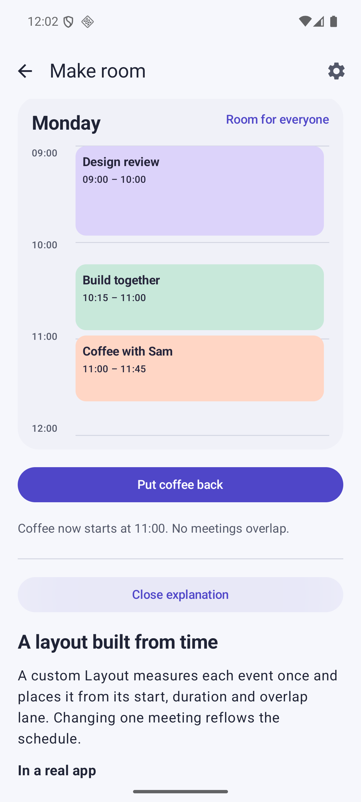

Every scene reveals a concise explanation after the working interface. It names
the mechanism, connects it to a real application and marks the simulation boundary.
Use the linked source files in this guide to follow the implementation. Captures
show particular states; test scope and environment belong in
[verification](verification.md), and API coverage in the [capability map](coverage.md).
