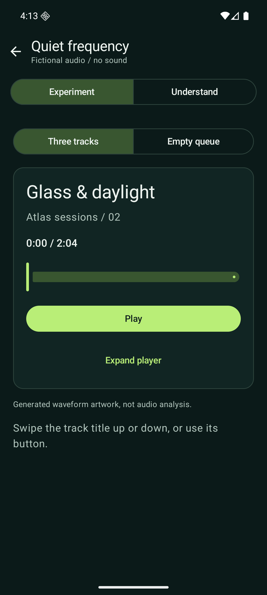
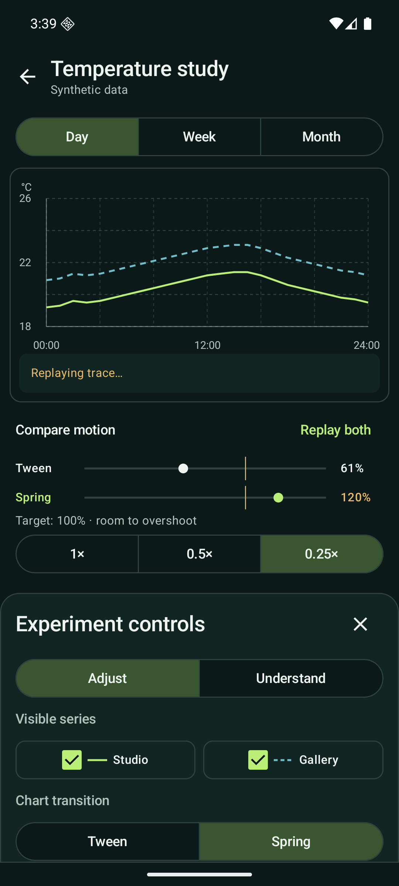
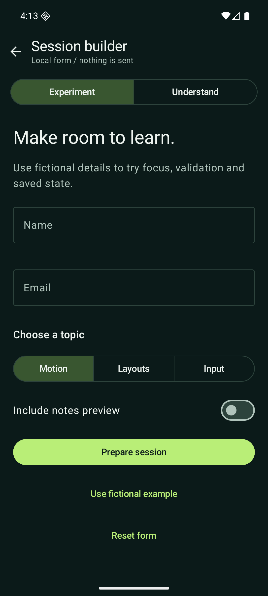
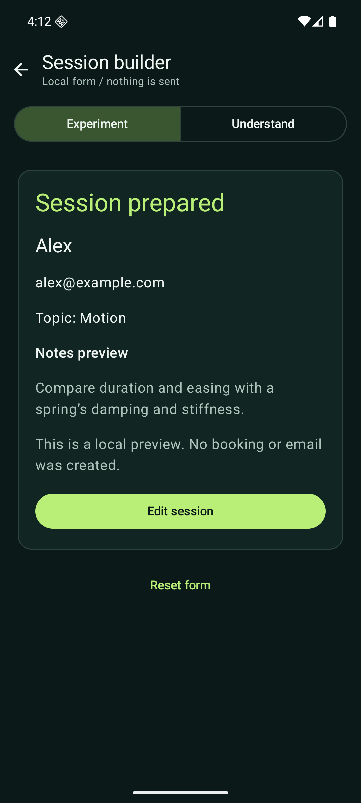
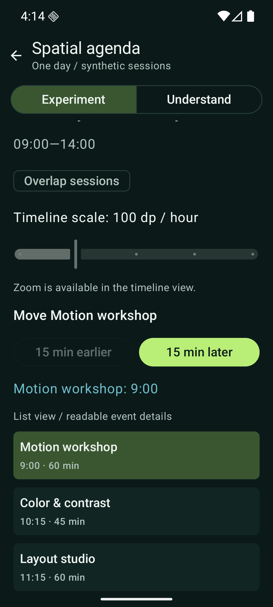
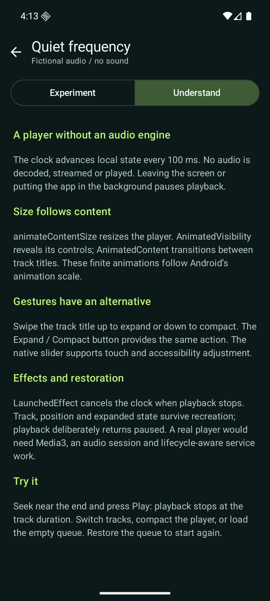

# A hands-on tour of Compose Atlas

[Back to the README](../README.md) · [Capability map](coverage.md) · [Verification](verification.md)

Open an experiment, try the sequence below, then switch to **Understand**.
All scenes work offline with synthetic data. These are native captures, not design
mockups. Gallery images show [v0.2.0](https://github.com/FredDevAxes/compose-atlas/tree/v0.2.0)
on an API 36 ARM64 emulator; the chart comparison capture comes from the
[preceding motion revision](https://github.com/FredDevAxes/compose-atlas/commit/84238116c4653854273217cf12cc1278b49f82a7), retained in that milestone.

## Quiet frequency — animation, gestures and effects

  
  

*Expanded and compact states of the fictional audio player.*

1. Press Play, seek near the end and watch playback stop at the track duration.
2. Change tracks to see the title transition. Swipe the track title down to compact
   the player, then up to expand it. The Expand / Compact button offers the same action.
3. Leave the scene and return: the selected track and position are retained, paused.
4. Load the empty queue and restore it to inspect the recovery path.

`AnimatedContent` changes the title, `AnimatedVisibility` reveals controls and
`animateContentSize` changes the container height. A cancellable `LaunchedEffect`
advances a simulated clock; a lifecycle observer pauses it in the background.
The waveform is geometric artwork. This scene does not decode or play audio.

[Player source](../app/src/main/java/dev/devaxes/composeatlas/ui/PlayerExperience.kt)

## Temperature study — Canvas and two kinds of motion

*The amber reference marks the target. Spring can pass it and settle back; Tween
uses its chosen duration and easing.*

1. Choose 0.25× and Replay both. Watch both markers start together and inspect the
   spring's overshoot. Change damping or stiffness and replay.
2. Tap or drag the chart, then use Previous point and Next point to inspect the
   same values without a precise gesture.
3. Toggle Studio or Gallery, and switch Day / Week / Month. Each period has its
   own deterministic fixture; these are not measured or aggregated temperatures.
4. Try Gaps, Empty and Long labels. Missing samples break the path and read as
   “No sample”; they never become zero. Reset restores the default settings.

`Animatable` drives the comparison. Playback speed stretches time without changing
easing, damping or stiffness; Android's disabled-animation setting stays authoritative.
The chart reveals an existing trace and clips it to the plot: animation overshoot
never fabricates a temperature. Back closes the controls before returning to Explore.

[Chart state](../app/src/main/java/dev/devaxes/composeatlas/ui/AtlasApp.kt) ·
[Motion comparison](../app/src/main/java/dev/devaxes/composeatlas/ui/MotionComparison.kt)

## Object collection — identity through change

*The collection keeps favorite state on object IDs as the visible order changes.*

1. Save Arc lamp, reverse the order, then enable Saved only.
2. Combine search with a category and switch between Grid and List.
3. Search for an absent object to inspect the empty result, then clear the filters.
4. Open Details, dismiss it and leave the scene. Return to check the saved state.

`LazyVerticalGrid` and `LazyColumn` use stable keys; `animateItem` makes placement
changes visible. Controls belong to the same lazy container so they remain reachable
in short windows and at large font sizes. All twelve objects are fictional.

[Collection source](../app/src/main/java/dev/devaxes/composeatlas/ui/CollectionExperience.kt)

## Session builder — input, focus and validation

  
  

*Input and local confirmation, with no network submission.*

1. Submit empty input and read the field-level errors.
2. Enter a name. Next on the keyboard moves focus to Email; Done runs validation.
3. Choose a topic and enable notes, then submit valid input to see the confirmation.
4. Edit the confirmation or reset the form and compare the transition.

Validation is derived from saved input state. `FocusRequester`, keyboard types and
IME actions connect the fields; animated content switches to the confirmation.
The email check is a local format check, not proof that an address can receive mail.

[Form source](../app/src/main/java/dev/devaxes/composeatlas/ui/FormExperience.kt)

## Spatial agenda — time becomes layout

  
  

*The regular timeline and its large-text list adaptation.*

1. Turn on overlap and compare the session columns.
2. Change the hour height, then move Motion workshop in 15-minute steps.
3. Open a session for its full details. Reset restores the starting schedule.
4. Increase system text size: the timeline becomes a chronological list and explains
   why timeline zoom is disabled there. Session details and movement stay available.

A custom `Layout` measures each session once and places it from start time, duration
and overlap lane. The Canvas grid shares its pixels-per-minute scale. Movement
clamps the entire event to the displayed day. This is deterministic layout geometry,
not calendar integration or a drag-and-drop scheduler.

[Agenda source](../app/src/main/java/dev/devaxes/composeatlas/ui/AgendaExperience.kt)

## Read the mechanism

*Every scene includes its own Understand tab; explanations and experiments keep
independent scroll positions.*

For implementation choices, read [architecture](architecture.md). For test scope,
environments and limitations, read [verification](verification.md). The
[coverage map](coverage.md) records what is implemented and what remains a candidate.
